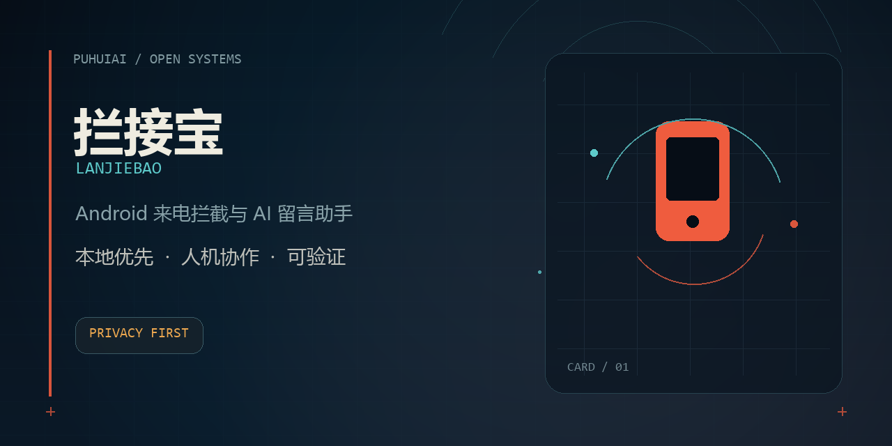

# 拦接宝 LanJieBao：Android 来电拦截与 AI 留言助手

拦接宝是一款面向 Android 的来电拦截与留言助手。它可以在本机识别骚扰电话、让 AI 代接可疑来电、保存留言与录音，并显示号码归属地。软件免费使用，闭源发布。

## 下载与安装

推荐从官方下载页获取最新版：**https://catshield.cn/dl/**

GitHub 备用下载：

| 版本 | 适用场景 | 安装包 |
|:---|:---|:---|
| v2.1.0 full | 测试者，包含短信拦截功能 | [LanJieBao-2.1.0-full.apk](https://github.com/puhuiai/lanjiebao/releases/download/v2.1.0/LanJieBao-2.1.0-full.apk) |
| v2.1.0 store | 应用商店与保守用户，不含短信权限 | [LanJieBao-2.1.0-store.apk](https://github.com/puhuiai/lanjiebao/releases/download/v2.1.0/LanJieBao-2.1.0-store.apk) |

安装后按引导开启来电识别、悬浮窗和通知权限。

## 核心功能

- 骚扰电话与可疑号码识别
- AI 代接来电、保存留言和录音
- 离线号码归属地查询，内置 51.7 万条号段
- 来电与留言记录推送
- 完整版与商店合规版双渠道安装包

## 隐私优先

号码与通话相关内容在本机处理。号段查询不联网、不上传号码。软件不收集与功能无关的个人信息。

## 系统要求

- Android 8.0 及以上
- 建议授予电话、通讯录、悬浮窗和通知权限

## 反馈

遇到问题请提交 [Issues](https://github.com/puhuiai/lanjiebao/issues/new/choose)，并附手机型号、系统版本、问题现象和复现步骤。

## 授权

拦接宝免费使用，闭源发布。禁止反编译、二次打包和商业转售。

Built by 汪君 · 普惠AI
